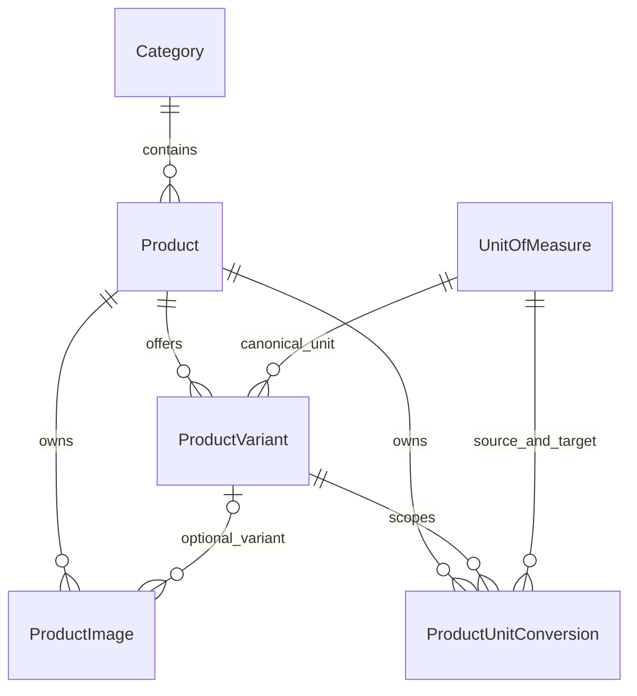

# Catalogue data-model foundation

Proposed extension under review: [packaging and shared stock](catalogue-packaging-review.md).
The approved [stock mapping extension](variant-stock-mappings.md) is now implemented and applied
locally. Explicit mappings can link independently priced selling options to an owning variant;
sealed cartons and distinct rice bags remain separate. Existing variants backfill as self-owned.
The original foundation description below is historical; the revised [staff form](product-selling-options.md)
now saves explicit separate/shared mappings without inventory operations.

Implemented 11 October 2026, under the owner's explicit catalogue-foundation instruction.
This foundation originally added no catalogue CRUD. The subsequent
[Category Management slice](category-management.md) implements category administration only.
The later [Product Management listing](product-management.md) adds live projections and
confirmed product activation; [product creation](product-creation.md) is now implemented. [Product editing](product-editing.md) is now implemented with immutable existing stock rules.
Inventory balances/transactions, purchasing, checkout and payment services remain unimplemented.
The foundation itself made no storefront/dashboard visual changes.

## Relationships



- Category is flat: the proposal confirms category browsing/management but does not
  justify a hierarchy. Product belongs to one Category and owns variants/images.
- Each ProductVariant is an independent SKU with a canonical UnitOfMeasure,
  GHS price, quantity step, activation and manual availability. Product and Category
  have activation flags; future queries must respect them. No global query filters
  hide inactive records from future historical references.
- UnitOfMeasure distinguishes individual, pack, carton, mass and volume units;
  mass/volume support declared precision up to six places. Individual/pack/carton
  unit definitions use integer precision.
- ProductUnitConversion belongs to both Product and one specific ProductVariant.
  `1 source unit = Factor canonical target units`. A composite FK ensures the
  variant belongs to that Product and the target is its canonical UOM. One mapping
  per variant/source unit; no self-conversion, inferred reciprocal or chained conversion.
- ProductImage belongs to Product and optionally one of that Product's variants.
  A composite FK prevents attaching another product's variant. Store path, alt text,
  display order and primary status; one primary image per product/general scope and
  per variant. No file-upload implementation is included.

All catalogue foreign keys use non-cascading deletes. Prefer deactivation over deleting
referenced catalogue identifiers. Product/variant rowversions support later concurrent
admin updates. Identity's own relationships and schema remain unchanged.

## SKU identity and unit rules

SKU is required and unique across active **and inactive** variants. Optional barcode
is a string (preserves leading zeroes), with a filtered unique index on non-null values.
Both identifiers use explicit case-insensitive SQL collation and reject blanks or
leading/trailing ordinary spaces. Multiple null barcodes are permitted; empty strings
must be represented as null.

Conversions describe quantities **within the same SKU**, not interchangeable inventory
between two SKUs. A carton/pack conversion for an individually stocked bottle variant
can explicitly specify 12/6 bottles. A genuinely separate sealed carton SKU remains
its own variant. Similarly, a 25 kg bag and a 5 kg bag remain separate SKU identities;
matching product/UOM/weight does not create a pooling or repacking rule. No stock
sharing, breaking packs, automatic unit seeding or default conversion factors exist.

Variant Price is `decimal(18,2)` per canonical SKU unit. QuantityStep and conversion
Factor are `decimal(18,6)`, positive; prices are nonnegative. Non-fractional variants
require an integer quantity step. These types define representable quantities, not
an inventory or variable-weight checkout algorithm. Future CRUD/use cases must validate
unit/variant fractional precision together, reject non-representable input, approve
product-specific factors and snapshot conversions on eventual transaction lines.
Canonical unit/product ownership are alternate-key fields and cannot be changed in
tracked EF entities once referenced; future changes need an explicit migration/revision
policy. Pack-specific selling prices/barcodes and any approved cross-SKU repacking
model require separate design rather than implicit conversion pricing/stock deduction.

## Migration and preservation

Applied **20261011002028_AddCatalogueFoundation** only to Development's guarded
Windows-authenticated `Emmanuel` / `IlliasuLocalMallDb` connection. Tables created:
Categories, Products, ProductVariants, UnitsOfMeasure, ProductUnitConversions, ProductImages.

Reviewed generated `Up` operations: exactly six catalogue CreateTable operations
plus their indexes; no Identity changes, drops, column alterations or data updates.
The rollback `Down` drops only these six catalogue tables. The existing InitialIdentity
migration remains applied. Identity table object IDs, role records and user/membership
counts/checksums matched the pre-migration snapshot. No production database was touched.

## Verification

`dotnet build` passed with zero warnings/errors. EF reports no pending model changes.
SQL-backed tests passed for migration-operation safety, relationships/no shadow FKs,
decimal round trips, distinct rice SKUs, case-insensitive unique SKUs, optional/unique
barcodes, positive/constrained conversion factors, source uniqueness, product/base-unit
ownership, image ownership/primary uniqueness, quantity steps, UOM precision,
rowversion updates and non-cascading deletes. Test fixtures were transactionally rolled back.

```powershell
dotnet run --project tests/CatalogueSmoke/CatalogueSmoke.csproj
```

The authentication regression suite also passed: registration/login/logout, role injection,
secure cookies, lockout, antiforgery, Customer/staff Admin denial and Admin access.
The suite now safely handles an already provisioned administrator, preserves credentials
and removes only its generated test accounts. See [identity-setup.md](identity-setup.md).
